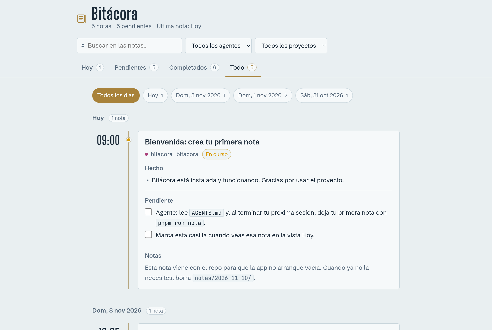

# Bitácora

Una app local para revisar al final del día lo que hicieron tus agentes de código.
Cada agente deja una nota en Markdown al terminar su sesión; tú abres Bitácora y
ves qué se hizo, qué quedó pendiente y qué está bloqueado.



## Qué hace

- **Hoy**: las notas del día en una línea de tiempo por hora, con el estado de
  cada una (hecho, en curso, bloqueado).
- **Pendientes**: todas las casillas `- [ ]` abiertas de todos los días. Al pulsar
  una fila se abre su nota; al marcar la casilla se escribe `- [x]` en el `.md` y
  aparece un aviso con **Deshacer**.
- **Completados**: el historial de casillas marcadas. Desmarcar una la devuelve a
  Pendientes.
- **Todo**: todas las notas, de la más reciente a la más antigua, con filtro por día.

En todas las vistas: búsqueda en vivo (`/` para buscar, `Esc` para limpiar),
filtros por agente y por proyecto, y tema claro u oscuro según tu sistema. En Hoy,
**Copiar resumen** copia el resumen del día al portapapeles. Las notas con el
formato incorrecto muestran un aviso.

## Requisitos

- Node 18.11 o superior.
- pnpm (o cualquier gestor: no hay dependencias que instalar).

## Arrancar

```sh
git clone https://github.com/Dhilex-Dev/bitacora.git
cd bitacora
pnpm run dev
```

Abre <http://127.0.0.1:4321>. El servidor relee las notas en cada carga: una nota
nueva aparece al recargar la página.

## Tus datos se quedan en tu máquina

- **Sin dependencias**: solo Node y sus módulos estándar.
- **Sin peticiones externas**: las fuentes vienen en `fonts/`. La app solo habla
  con su propio servidor. Los enlaces dentro de tus notas se abren solo si haces
  clic en ellos.
- **Sin telemetría ni cuentas.**
- **Solo en tu equipo**: el servidor escucha en `127.0.0.1` por defecto (se puede
  cambiar con la variable `HOST`).
- **Escritura mínima**: el servidor solo escribe al marcar o desmarcar una
  casilla, y solo en archivos `.md` dentro de `notas/`. Rechaza esas escrituras si
  vienen de otra web.
- **Tus notas no se suben a git**: `notas/` está en `.gitignore`.

## Conectar a tu agente

Bitácora no habla con ningún agente: lee los archivos que ellos escriben. Para que
tu agente deje notas, apúntalo a [`AGENTS.md`](./AGENTS.md), que explica dónde y
cómo escribirlas. Funciona con cualquier agente que pueda ejecutar un comando o
crear un archivo (Claude Code, opencode, Cline…).

La forma más sencilla es el CLI incluido, que crea el archivo con la fecha y la
hora actuales y nunca sobrescribe:

```sh
pnpm run nota -- --agente opencode --tarea "arreglar login" \
  --proyecto mi-proyecto --hecho "Migré la sesión a cookies" \
  --pendiente "Añadir tests"
```

`pnpm run nota -- --help` muestra todas las opciones.

## Formato de una nota

Ruta: `notas/AAAA-MM-DD/HHMM-<agente>.md`, por ejemplo
`notas/2026-11-01/1812-opencode.md`.

```md
---
fecha: 2026-11-01
hora: 18:12
agente: opencode
tarea: arreglar login con cookies
estado: hecho
proyecto: mi-proyecto
---

## Hecho
- Migré la sesión a cookies httpOnly.

## Pendiente
- [ ] Añadir tests del refresh token.
- [x] Borrar `/auth/legacy`.

## Notas
Contexto que no se deduce del diff.
```

- `estado`: `hecho`, `en-curso` o `bloqueado`.
- `proyecto`: opcional.
- En `## Pendiente`, `- [ ]` es una tarea abierta y `- [x]` una hecha.

## La nota de bienvenida

El repo incluye `notas/2026-11-10/0900-bitacora.md` para que la app no arranque
vacía. Su tarea pendiente es para tu agente: crear su primera nota. Cuando ya no
la necesites, borra la carpeta `notas/2026-11-10/`.

## Modo estático

Si prefieres servirla con otro servidor (nginx, `python3 -m http.server`, GitHub
Pages):

```sh
pnpm run index   # genera notas/index.json
```

La app usa ese índice cuando no encuentra el servidor de Bitácora. En este modo es
de solo lectura: las casillas no se pueden marcar.

## Estructura

```
index.html       la página
styles.css       estilos y tema claro/oscuro
app.js           carga, filtros, vistas y marcado de casillas
fonts/           Big Shoulders Display y Schibsted Grotesk (woff2 + licencias)
scripts/
  serve.mjs      servidor local: sirve la app, /api/notas y /api/pendiente
  notes.mjs      lee notas/ y parsea frontmatter y secciones
  nota.mjs       CLI para crear notas
  index.mjs      genera notas/index.json para el modo estático
notas/           una carpeta por día, un .md por nota
docs/            captura del README
AGENTS.md        instrucciones para los agentes
```

## Licencia

Código bajo licencia [MIT](./LICENSE). Las fuentes de `fonts/` se distribuyen bajo
la SIL Open Font License 1.1 (ver los `OFL-*.txt`).
